# 07. 플레이 검수와 조작감·적 이동 수정

- 날짜: 2026-11-24
- 브랜치: `polish/game-feel`
- 기준 상태: `perf/enemy-ab` `6ce8ca1`에 `origin/WH_Dodge` `26873a5`(회피, 후딜 캔슬, 궁극기)를 병합한 것(이 브랜치의 병합 커밋). 이 문서의 "수정 전"은 이 상태다.
- 측정 방법: 실제 씬 `Main.unity`에 가상 키보드·마우스 입력을 넣어 한 판을 자동으로 재현하고, 프레임마다 위치와 애니메이션 상태를 기록했다. Unity 6000.3.24f1 Editor 배치 실행, Mac(Apple M5 Pro), 60fps 고정 간격.
- 측정의 한계: 입력 장치와 모니터의 지연은 들어 있지 않다. 시연 PC에서는 재지 않았다. 움직임은 수치와 정지 화면으로 확인했고, 사람이 직접 플레이하며 본 것은 아니다.
- 범위: 조작감과 적 이동은 고쳤다. 맵은 검수만 했다(5장).

## 1. 요약

게임이 프로토타입처럼 보인 가장 큰 이유 네 가지는 취향이 아니라 결함이었다.

| 결함 | 수정 전 | 수정 후 |
| --- | --- | --- |
| 적이 끊기며 느리게 움직임 | 두 프레임 중 한 프레임(실행에 따라 세 프레임 중 한 프레임)만 움직였고, 다가오는 속도는 1.15m/s였다(설정값 3.5m/s) | 매 프레임 움직이고 평균 3.33m/s |
| 적이 바닥에서 떠 있음 | 발바닥이 바닥 위 22cm | 0cm |
| 적이 제자리에서 걷는 동작을 함 | 걷는 동작이 나오는 시간의 50~67%가 제자리 | 0.1% |
| 적에게 둘러싸이면 플레이어가 갇힘 | 0.75초 달려 0.9m, 회피 0.7~1.1m | 6.5m, 6.9m (적이 없을 때와 같음) |

그 밖에 고친 것은 다음과 같다.

- 달리기 시작과 정지가 0.5초씩 걸리던 것을 0.1초 안팎으로 줄였다.
- 공격 연타가 버려지던 것을 보관했다가 이어지게 했다.
- 중력이 없어 한 번 올라가면 내려오지 않던 것을 고쳤다.
- 카메라가 벽을 뚫고 나가 플레이어가 안 보이던 것을 고쳤다. 2026-11-25에 빠른 이동 중 벽에 닿던 프레임과 벽을 등졌을 때의 화면도 고쳤다(`08_NEON_CITY_STAGE.md` 3.5절).
- 적 걷기·달리기 클립을 발이 땅에 붙도록 다시 만들었다.

남은 것은 다음과 같다.

- 플레이어의 공격 속도와 후딜 같은 수치는 건드리지 않았다(2.3절에 제안).
- 플레이어 달리기의 발 미끄러짐은 줄었지만 남아 있다(2.3절).
- 맵은 손대지 않았다(5장).
- 적 속도가 실제로 3배가 되어 한 판의 난이도가 달라진다. 팀이 정해야 한다(6장).

## 2. 조작감

### 2.1 발견, 원인, 조치

| 증상 | 수정 전 | 원인 | 조치 | 수정 후 |
| --- | --- | --- | --- | --- |
| 적 무리 속에서 움직이지 못함 | 달리기 0.75초에 0.9m (적이 없으면 4.9m). 회피는 0.7~1.1m (설정 6m) | 플레이어 충돌체가 적 충돌체(가로 1.4m 상자)에 막힌다. 적은 플레이어에게 2m까지 붙는다 | 플레이어는 적을 지나가고, 플레이어 자리(반경 0.9m) 안에 든 적이 물러난다. 공격 전진만은 맨 앞 적 앞에서 멈춘다 | 달리기 6.5m, 회피 6.9m. 무리 속 연타 7.3초에 처치 41(전 38) |
| 공격 연타가 먹히지 않음 | 첫 클릭 뒤 0.30초, 0.45초에 누른 두 번째 클릭이 버려짐. 0.15초에 누르면 첫 공격을 건너뛰고 0.28초에 두 번째 공격이 나감 | 콤보 구간(공격 시작 0.5초 뒤부터) 밖의 입력을 버린다. 또 상태를 판단할 때 전환 중인 상태가 아니라 떠나는 상태를 봤다 | 누른 입력을 0.4초 보관했다가 구간이 열리는 첫 프레임에 쓴다. 전환 중에는 들어가는 상태로 판단한다 | 0.15·0.30·0.45초 모두 0.55초에 두 번째 공격 |
| 출발이 굼뜸 | 최고 속도의 90%까지 0.47초. 첫 0.5초에 2.6m | 가속 20m/s² (최고 속도 10m/s) | 가속 90m/s² | 0.12초, 4.5m |
| 멈출 때 미끄러짐 | 0.50초 동안 2.4m 더 감. 멈춘 자세까지 1.05초 | 감속이 가속과 같은 20m/s². 정지 클립이 1초짜리 | 감속 120m/s². 몸이 멈추면 정지 클립을 2배속으로 | 0.08초, 0.33m. 멈춘 자세까지 0.67초 |
| 짧게 누르면 거의 안 움직임 | 0.1초 누르면 0.2m | 위와 같음 | 위와 같음 | 0.79m |
| 방향을 뒤집으면 뒷걸음으로 미끄러짐 | 몸은 0.25초에 걸쳐 도는데 이동은 즉시 뒤로. 보는 방향과 반대로 9프레임 이동 | 이동 방향은 즉시 바뀌고 회전은 720°/s | 속도를 0을 거쳐 뒤집고 회전은 1440°/s | 1프레임. 회전 0.13초 |
| 한 번 올라가면 떠 있음 | 3m 위에 놓아도 내려오지 않음. 낮은 구조물을 밟고 지나가면 0.3~0.4m 뜬 채로 다님 | 이동에 수직 성분이 없다 | 중력과 바닥 붙이기 | 바닥으로 내려옴 |
| 벽 앞에서 플레이어가 안 보임 | 벽에서 1m 떨어져 서면 카메라(뒤 4m)가 벽 너머에 있음 | 카메라가 장애물을 검사하지 않는다 | 플레이어와 카메라 사이에 지형이 있으면 카메라를 당긴다. 물러날 때는 천천히 | 카메라가 0.7m까지 당겨지고 플레이어가 보임 |
| 공격할 때 오류 로그 | 공격하면 `AnimationEvent 'Sheathe' on animation 'Attack1' has no receiver` 오류가 찍힘(테스트 로그에서 확인. 횟수는 세지 않았다) | 포즈만 따라 읽는 보조 Animator가 클립 이벤트를 받을 대상 없이 발생시킨다 | 보조 Animator의 이벤트를 끔 | 같은 테스트에서 0건 |

벽 앞 카메라의 수정 전후는 아래와 같다.

| 수정 전 | 수정 후 |
| --- | --- |
| 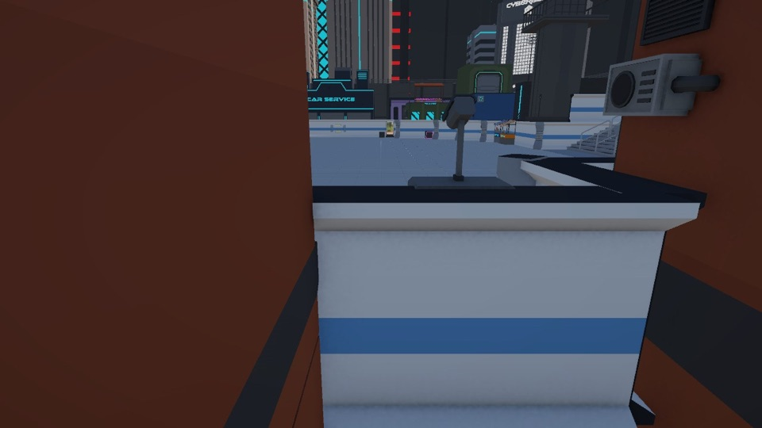 | 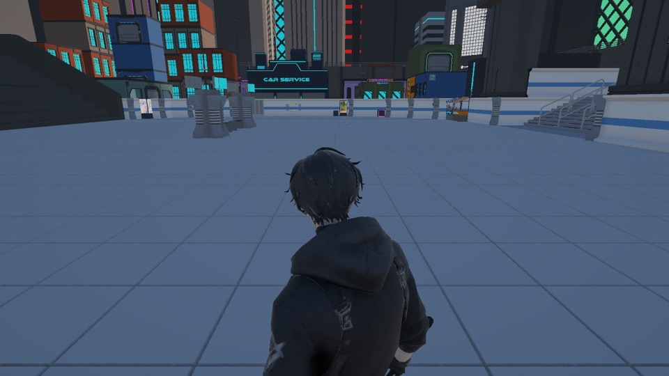 |

### 2.2 다른 게임과 견준 것

출처는 10장에 있다. 다른 게임의 수치는 그 자료가 잰 방식 그대로이고, 이 문서의 측정과 조건이 같지 않다.

- 입력 뒤 화면이 반응하기까지를 실제 기기로 잰 자료에서, 반응이 좋다고 평가된 게임은 4프레임(60분의 4초), 굼뜨다는 평을 들은 게임은 10프레임이었다. 우리 게임은 입력을 읽은 바로 다음 프레임에 애니메이션과 이동이 시작된다. 지연 자체는 문제가 아니었다.
- 니어 오토마타는 기본 공격의 판정이 누른 뒤 약 10프레임(0.16초)에 나오고, 회피는 거의 언제나 쓸 수 있다고 한다. 우리 게임의 첫 공격 판정은 약 0.24초다(클립의 판정 이벤트 0.17초를 재생 속도 0.7로 나눈 값). 회피로 공격을 끊는 것은 우리도 5프레임 안에 된다.
- 조작이 다시 가능해지기까지의 후속 동작이 길면 반응이 나쁘게 느껴진다는 것이 애니메이션 쪽의 일반 원칙이다. 우리는 공격 한 번 뒤 이동이 풀리기까지 0.85초, 회피 뒤 0.87초다. 이 값은 그대로 두었다.
- 카메라는 장애물을 미리 찾아 부드럽게 피하고, 급히 튀지 않아야 한다는 것이 정리된 조언이다. 이번에 당기는 것만 넣었다. 미리 돌아가는 것은 넣지 않았다.

### 2.3 그대로 둔 값과 제안

아래는 플레이어 담당 팀원이 정한 전투 수치라서 바꾸지 않았다. 측정값과 함께 제안만 적는다.

| 항목 | 지금 | 측정된 결과 | 제안 |
| --- | --- | --- | --- |
| 공격 1·2 재생 속도 | 0.7배 | 첫 판정 0.24초. 연타해도 초당 2회 | 0.85~1.0배 |
| 후딜 캔슬 시각 | 공격 1은 0.8초, 공격 2는 1.1초 | 공격 한 번에 0.85초 동안 이동 불가 | 0.5초, 0.6초 |
| 콤보 구간 시작 | 공격 길이의 30% (0.5초) | 판정(0.24초) 뒤 0.26초를 기다려야 다음 공격 | 20% |
| 회피 캔슬 시각 | 0.7초 (구르기 0.73초) | 회피 뒤 0.87초 동안 조작 불가. 무적은 0.5초에 끝남 | 0.45~0.5초 |
| 대기에서 공격으로 넘어가는 블렌드 | 0.25초 | 공격 앞부분이 대기 자세와 섞여 흐릿함 | 0.08초 |
| 공격 전진 | 0.1초에 3m (초속 30m) | 순간이동처럼 보임. 카메라 추적점을 0.06초로 완만하게 해 화면 흔들림만 줄였다 | 0.15~0.2초에 걸쳐서 |
| 이동 속도와 달리기 클립 | 10m/s, 클립은 4.72m/s용 | 땅에 닿은 발이 4.7m/s로 미끄러졌다. 달리기 클립을 1.25배로 돌려 3.4m/s로 줄였다 | 이동 속도를 7.5m/s 근처로 낮추거나, 10m/s용 달리기 클립을 구한다 |

회피의 "적 통과" 옵션(`DodgeData.passThroughEnemies`)은 꺼져 있어도 이제 통과한다. 꺼 둔 상태에서 회피가 무리 속에서 1m도 가지 못했기 때문이다. 막히는 쪽을 원하면 말해 달라.

## 3. 적 이동

### 3.1 발견, 원인, 조치

| 증상 | 수정 전 | 원인 | 조치 | 수정 후 |
| --- | --- | --- | --- | --- |
| 끊기며 느리게 다가옴 | 움직이는 프레임이 절반(실행에 따라 3분의 1). 3초 동안 다가온 속도 평균 1.15m/s (설정 3.5m/s) | AI는 Transform을 직접 옮기는데, 적의 Rigidbody가 보간(Interpolate)을 켠 kinematic 상태라 매 프레임 자기 자세로 Transform을 되돌린다. 물리 갱신이 있는 프레임의 이동만 남는다 | AI가 움직이는 동안은 보간을 끄고, 맞아서 물리로 날아가는 동안만 켠다 | 매 프레임 이동. 평균 3.33m/s (적마다 ±12% 편차를 줌) |
| 바닥에서 떠 있음 | 가장 낮은 발바닥이 기준점 위 0.223m | 프리팹을 만들 때 실제 메시가 아니라 여유가 붙은 렌더러 경계에 맞춰 높이를 정했다 | 모델 높이 한 값을 내려 발바닥을 바닥에 맞춤 | 0.000m |
| 제자리에서 걷는 동작 | 걷는 동작이 나오는 시간의 50~67%가 제자리 | 공격 거리 안에서 쿨타임을 기다리는 동안 상태가 추격으로 남아 걷는 클립이 계속 돈다 | 실제로 움직일 때만 걷기·달리기를 보이고, 서 있으면 대기 자세 | 0.1% |
| 다리만 흔들리는 걷기 | 골반 높이 변화 0. 땅에 닿아야 할 발이 초속 4m로 미끄러짐 | 클립이 관절 각도를 사인 곡선으로 흔든 것이다. 골반은 고정이고 발 위치는 계산하지 않았다 | 발 위치를 먼저 정하고(디딘 동안 땅에 고정) 다리 관절을 역산해 클립을 굽는다. 골반 상하·좌우 이동, 몸통 반대 회전, 팔 흔들기 추가 | 골반 4.6cm 오르내림. 디딘 발의 속도 평균 0.20m/s (달리기), 0.05m/s (걷기) |
| 같은 파도의 적이 발맞춰 걸음 | 걷는 박자가 파도(5명)마다 하나. 35명이 7가지 박자 | 클립을 항상 처음부터 재생 | 적마다 시작 박자, 속도(±12%), 크기(±4%)를 다르게 | 24명이 24가지 박자 |
| 방향이 한 프레임에 꺾임 | 한 프레임 최대 145° 회전 | 매 프레임 이동 방향으로 즉시 회전 | 초당 420°로 제한. 가까이서는 플레이어를 본다 | 한 프레임 최대 7° |
| 동작이 뚝뚝 끊김 | 상태가 바뀔 때마다 클립이 첫 프레임부터 즉시 재생 | `Animator.Play` | 0.06~0.2초에 걸쳐 섞는다. 맞았을 때와 죽을 때만 즉시 | 섞임 |
| 벽 밖에서 생겨 벽을 뚫고 들어옴 | 15초 시점 화면에서 2명이 벽 밖(4장 그림. 다른 실행에서는 3명) | 플레이어 둘레 15~25m 고리에서 무작위로 생기는데 경기장 벽이 20.7m에 있다. 적은 벽을 무시하고 직선으로 걷는다 | 생성 위치와 플레이어 사이에 지형이 있으면 다시 뽑는다(최대 8번) | 12초 동안 생긴 적의 95% 이상이 막힘 없는 위치(테스트 기준) |
| 종료 연출 동안 제자리 달리기 | TIME UP 슬로모션 2.5초 동안 추격하던 적이 제자리에서 걷는 동작을 한다(코드로 확인. 화면으로 재지는 않았다) | Finishing에서 AI는 멈추지만 클립은 계속 돈다 | Finishing에 들어가면 대기 자세로 선다 | 대기 자세(테스트로 확인) |

떠 있던 발과 다시 만든 달리기 동작은 아래와 같다. 아래 연속 그림은 한 주기를 10장으로 나눈 것이고, 윗줄이 옆, 아랫줄이 앞이다.

| 수정 전 | 수정 후 |
| --- | --- |
| 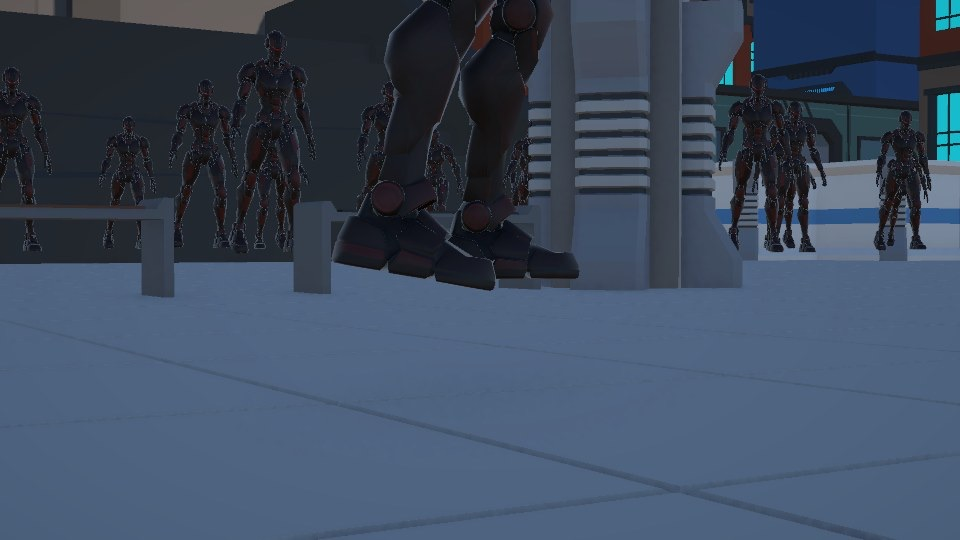 | 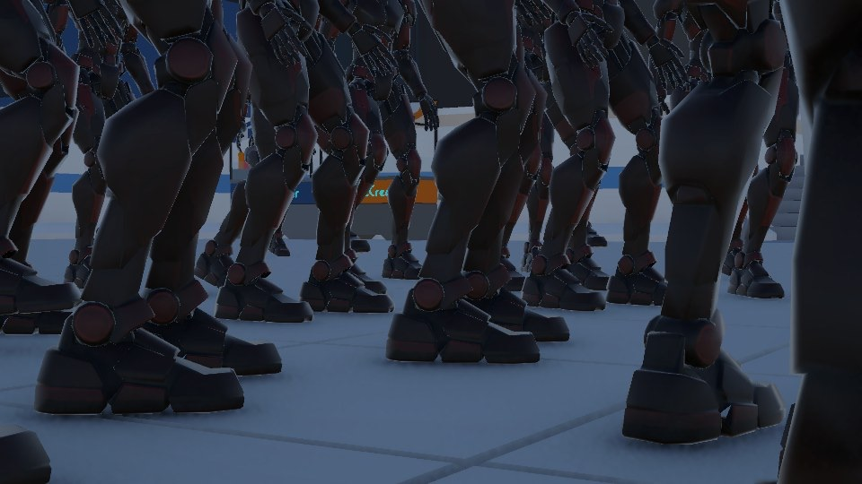 |

수정 전 달리기(설정 속도 3.5m/s용 클립):

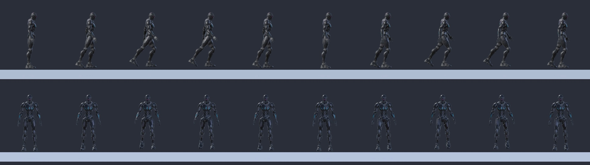

수정 후 달리기:

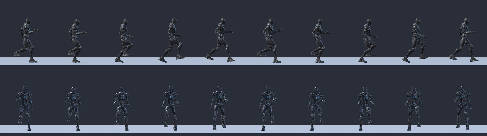

수정 후 걷기(초속 2m 아래에서 쓰는 새 클립):

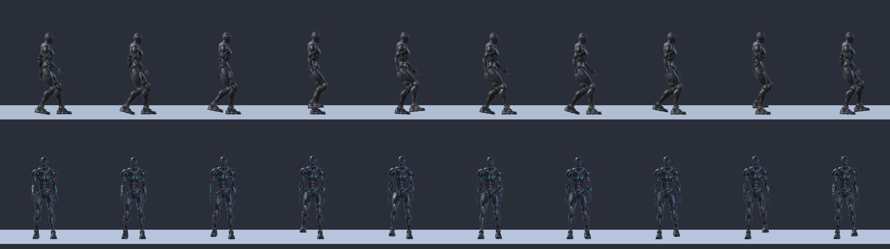

### 3.2 클립을 만드는 방식

적 클립은 내려받은 모션이 아니라 `GameDemoHumanoidEnemyBuilder`가 계산해 굽는다. 이 구조는 그대로 두고 계산만 바꿨다(`Assets/Editor/EnemyGait.cs`).

- 한 발은 주기의 정해진 구간 동안 땅에 있고, 그동안 몸에 대해 정확히 클립의 기준 속도로 뒤로 간다. 그래서 클립을 "실제 속도 ÷ 기준 속도"로 재생하면 디딘 발이 땅에서 움직이지 않는다.
- 떼기 직전에는 발이 앞꿈치를 축으로 굴러 올라간다. 이 모델은 밑창이 두꺼워(발목이 바닥 위 15cm) 이것을 빼면 밑창이 눈에 띄게 끌린다.
- 다리 길이, 발목 높이, 밑창 길이는 리그와 메시에서 잰다. 좌우 다리를 따로 잰다(자동 리그라 4mm 다르다).
- 달리기는 기준 속도 3.5m/s에 한 주기 0.6초이고 두 발이 모두 뜨는 구간이 있다. 걷기는 1.1m/s에 0.8초이고 항상 한 발이 땅에 있다. 초속 2m를 경계로 고른다. 이 값들은 임시값이다.
- 다시 구우려면 `Tools > Game Demo Enemy > Rebuild Humanoid Enemy Clips`. 프리팹은 모델 높이 한 값만 바뀐다.

### 3.3 다른 게임과 견준 것

- Unity 내비게이션 문서는 애니메이션이 이동 속도를 따라가지 못하면 발이 미끄러진다고 적고, 속도를 애니메이션에 넘기거나 애니메이션이 이동을 끌게 하라고 한다. Unreal은 보폭을 실제 속도에 맞춰 늘이고 줄이는 기능을 둔다. 이번 수정은 재생 속도를 실제 속도에 맞추는 쪽이다.
- 레프트 4 데드는 계산된 경로를 그대로 따라가면 로봇처럼 보인다고 보고, 앞쪽 지점을 향해 조향하며 서로 피하게 했다. 또 플레이어에게 보이지 않는 곳에서 적을 만든다. 우리는 탁 트인 경기장에서 적이 갑자기 나타난다. 이번에는 벽 밖 생성만 막았다.
- 플레이어를 둘러싼 자리와 동시에 공격하는 수에 정원을 두고, 차례가 아닌 적은 바깥에서 기다리게 하는 방식이 널리 쓰인다. 이번에 "이미 있는 몸으로 걸어 들어가지 않는다"는 규칙만 넣었고, 그 결과 2.5m 안에 10~11명이 서고 나머지는 뒤에서 기다린다. 동시에 공격하는 수의 정원은 넣지 않았다.

## 4. 군중

플레이어가 가만히 서 있을 때 14초 시점의 값이다. 이때 적은 65명이다.

| 항목 | 수정 전 | 수정 후 |
| --- | --- | --- |
| 플레이어 2.5m 안의 적 | 4명 (대부분 아직 도착하지 못함) | 11명 |
| 4m 안의 적 | 9명 | 34명 |
| 0.9m보다 가까이 겹친 적 쌍 | 0 | 2 (몸끼리 피하는 규칙을 넣기 전에는 20) |
| 15초 동안 플레이어가 맞은 횟수 | 4 | 12 |

| 수정 전 | 수정 후 |
| --- | --- |
| 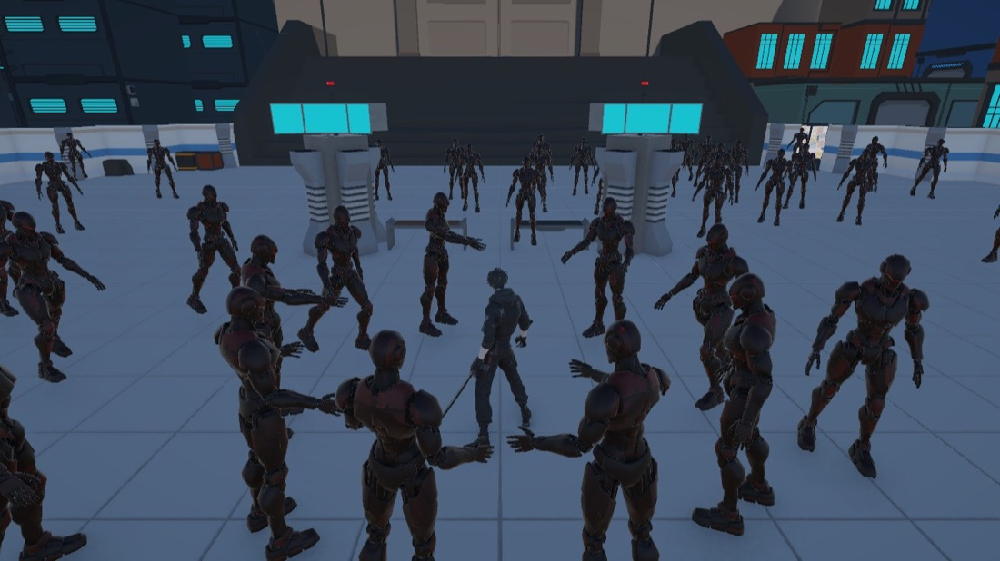 | 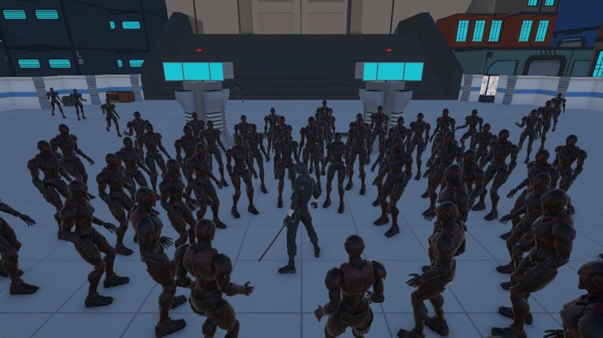 |
| 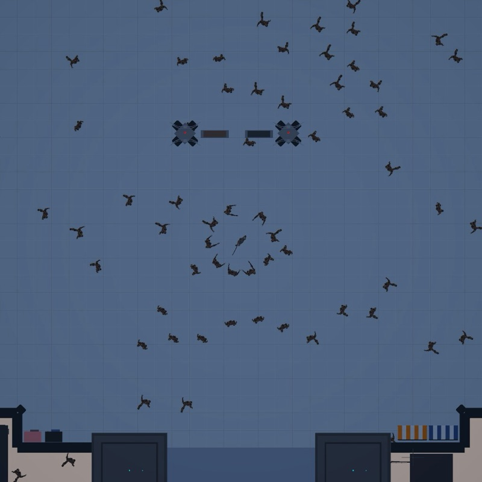 | 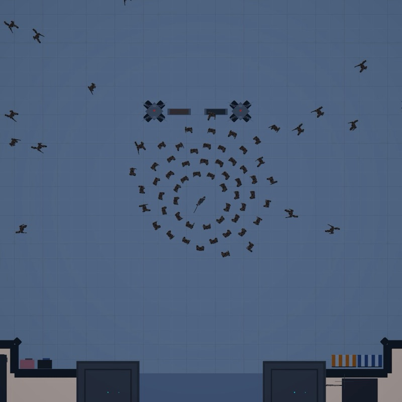 |

위에서 본 그림의 수정 전에는 왼쪽 아래 벽 밖에 적 2명이 있다.

## 5. 맵 (검수만 함)

> 이 절은 검수 시점의 기록이다. 맵은 그 뒤 새 씬으로 다시 만들었다. `08_NEON_CITY_STAGE.md`를 본다.

### 5.1 빌드에 들어가는 씬 `Main.unity`

| 항목 | 확인한 것 |
| --- | --- |
| 조명 | 흰색 방향광 하나(세기 2). 주변광은 기본 하늘에서 온다. 안개 없음. 구운 조명, 라이트 프로브, 반사 프로브 없음 |
| 후처리 | Unity 기본 견본 프로파일(톤 매핑, 블룸, 비네트) 그대로 |
| 표면 | 보이는 렌더러 1,291개 가운데 562개가 모듈 키트의 무늬 없는 기본 재질 하나를 쓴다. 바닥은 같은 타일 346장이다. 기본 큐브가 148개 있다 |
| 구성 | 싸우는 공간은 약 41×38m의 평평한 직사각형이고, 안에는 기둥 둘과 벤치 둘뿐이다. 눈에 띄는 기준물도, 적이 어디서 오는지 알려 주는 것도 없다 |
| 그림자 | 건물 그림자가 바닥의 절반을 덮어 그 안에서는 캐릭터와 바닥이 같은 밝기로 뭉친다 |
| 충돌 | 서쪽 벽 옆 가구 소품(`SM_Props_Furniture_02 (2)`)과 벽 사이로 벽을 따라 남쪽으로 달리면 몸이 걸려 멈춘다. 좌표 (-44.1, 49.7) |
| 캐릭터 | 플레이어도 적도 어두운 색이다 |

| 빌드 씬 | 레벨 디자인 미리보기 씬 |
| --- | --- |
| 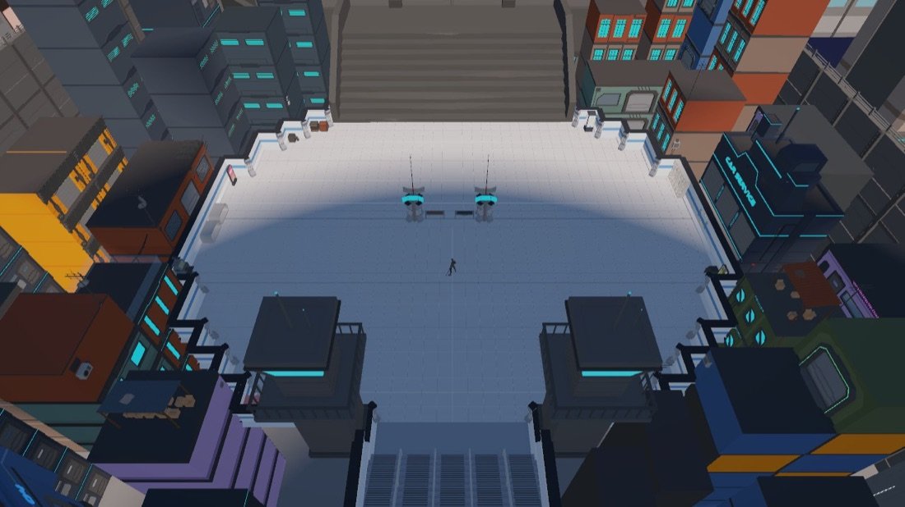 | 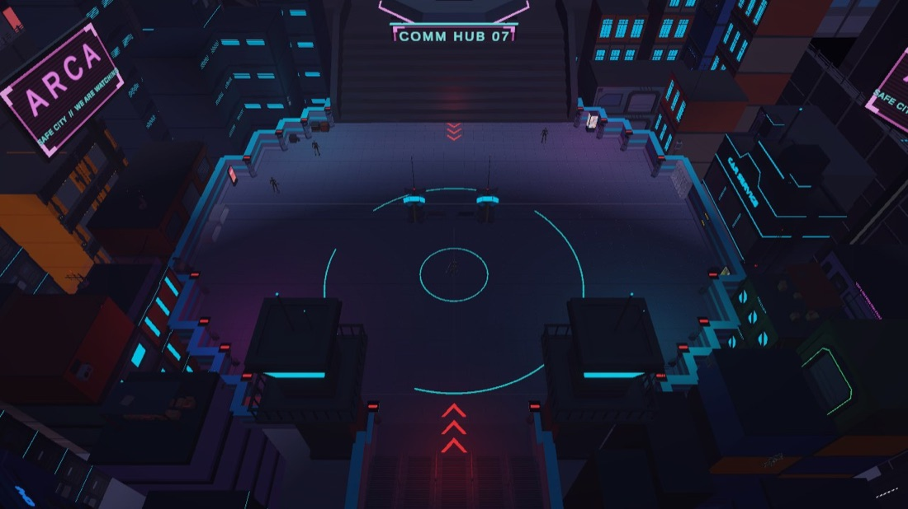 |
| 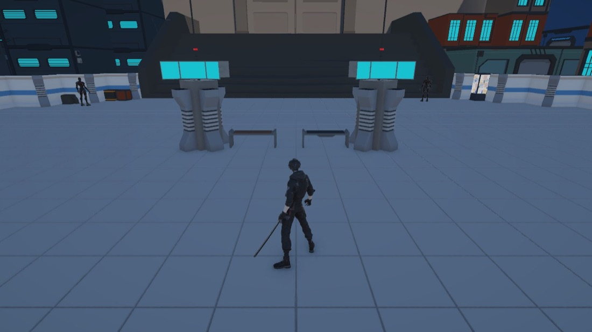 | 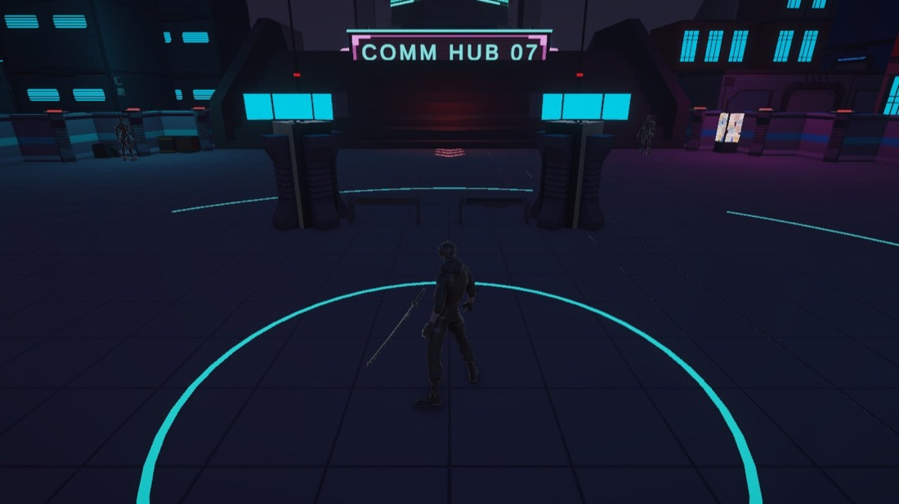 |

### 5.2 미리보기 씬 `Main_RebootHub.unity`

밤 조명(방향광 1, 스폿 1, 색이 다른 점광 6), 안개, 간판, 바닥의 원과 출입구 표시가 이미 있다. 빌드 씬보다 훨씬 완성돼 보인다. 남은 문제는 세 가지다.

- 플레이어와 적이 어두운 바닥에 묻혀 거의 보이지 않는다(위 오른쪽 아래 그림). 전투 게임에서는 이것이 가장 먼저 고칠 것이다.
- 싸우는 공간 한가운데는 여전히 비어 있다.
- CC0 소품을 놓은 작업은 `컴퓨터게임설계 팀프-level-design` 폴더에 커밋되지 않은 채 있다. 이 브랜치에는 없다.

### 5.3 다른 게임과 견준 것

- 레벨 디자인 교재는 단순한 덩어리로 만든 초안(블록아웃)을 시작으로만 보고, 그 위에 설계를 돕는 장식을 큰 형태부터 입히라고 한다. 조명이 고르면 공간이 밋밋하고 미완성으로 보인다고도 적는다. 빌드 씬은 조명 단계가 기본값에 머물러 있다.
- 팀 포트리스 2는 배경의 반복과 잡음을 줄이고 채도를 낮춘 뒤, 캐릭터에 테두리 빛을 줘 배경에서 떼어 냈다. 우리는 캐릭터와 배경이 같은 어두운 톤이다.
- 기준물은 하늘에 걸린 장식이 아니라 플레이에 쓸모가 있어야 한다고 한다. 우리 경기장에는 "적이 저기서 온다"를 알려 주는 것이 없다.
- 탁 트인 평평한 경기장은 군중 전투에 맞는 형태이고, 엄폐물이 많으면 오히려 미로가 된다고 한다. 그래서 공간을 메우는 것보다 조명, 캐릭터 가독성, 출입구가 먼저다.

### 5.4 고치지 않은 이유와 할 일

맵을 고치려면 `RebootHubEnvironmentBuilder.cs`와 미리보기 씬을 바꿔야 하는데, 같은 파일이 level-design 폴더에서 커밋되지 않은 채 바뀌어 있다. 여기서 따로 고치면 두 작업이 갈라진다. 그 작업을 먼저 커밋한 뒤 그 위에서 이어 가야 한다.

순서 제안은 다음과 같다.

1. CC0 소품 작업을 커밋한다.
2. 캐릭터가 보이게 한다. 경기장 위에서 비추는 밝은 주광, 캐릭터 테두리 빛, 적 얼굴 가리개의 발광 가운데 필요한 만큼.
3. 출입구를 적이 나오는 곳으로 쓴다. 지금은 고리 위 아무 데서나 생긴다. 생성 규칙이 바뀌므로 팀 결정이 필요하다.
4. 가운데에 기준물 하나를 둔다.
5. 걸리는 소품의 충돌체를 정리한다.
6. 미리보기 씬의 환경을 빌드 씬에 넣을지 팀이 정한다.

## 6. 팀이 정할 것

1. **적 이동 속도.** 지금까지 본 적은 초속 약 1.15m였다(60fps 기준. 프레임률에 따라 달랐다). 이제 설정값 3.5m/s 그대로 움직인다. 15초 서 있을 때 맞는 횟수가 4에서 12로 늘었다. 3.5로 둘지, 예전 체감에 맞춰 1.2 근처로 낮출지 정해야 한다. `EnemySettings.moveSpeed` 한 값이다. 2m/s 아래로 낮추면 걷기 클립이 쓰인다.
2. **플레이어 전투 수치.** 2.3절의 제안을 적용할지.
3. **회피의 적 통과.** 이제 항상 통과한다(2.3절).
4. **군중 간격.** `EnemySettings.bodySpacing` 1.1m. 플레이어에게 동시에 붙는 적이 10~11명으로 정해진다. 줄이면 더 촘촘해지고 더 많이 맞는다.
5. **맵.** 5.4절.

## 7. 바뀐 파일

담당자별로 적는다. 모두 `polish/game-feel` 브랜치에만 있고, 팀원의 브랜치에는 들어가지 않았다.

플레이어 담당 팀원의 영역:

- `Assets/Scripts/Runtime/Player/PlayerRuntime.cs`: 이동(속도 벡터, 감속, 방향 전환), 중력, 공격 입력 보관, 전환 중 상태 판단, 카메라 충돌과 추적, 달리기 클립 재생 속도, 적 통과.
- `Assets/Scripts/Runtime/Player/PlayerLocomotion.cs` (새 파일): 속도 계산 규칙. 테스트하기 쉽게 따로 뺐다.
- `Assets/Scripts/Player/PlayerDodge.cs`: 회피 입력 0.2초 보관.
- `Assets/Scripts/Player/PlayerAttackLunge.cs`: 전진이 맨 앞 적 앞에서 멈춤.
- `Assets/Scripts/Player/ReferenceAnimatorSync.cs`: 보조 Animator의 이벤트 끔.
- `Assets/Prefabs/Character/Player.prefab`: 두 값. `acceleration` 20 → 90, `rotationSpeed` 720 → 1440.
- Animator 컨트롤러, 공격·회피 데이터 에셋은 건드리지 않았다.

적 담당 팀원의 영역:

- `Assets/Scripts/Runtime/Enemy/EnemyAgent.cs`: 이동(가속, 회전 제한, 몸 피하기, 플레이어 자리 비우기), 보간 전환, 보이는 동작 선택, 적마다 편차.
- `Assets/Scripts/Runtime/Enemy/EnemyRuntime.cs`: 생성 위치 검사, 생성 때 플레이어를 보게 함, Finishing에서 세움.
- `Assets/Scripts/Runtime/Enemy/EnemySettings.cs`: 새 설정 11개(모두 임시값, Inspector에서 조절). 기존 값은 그대로다.
- `Assets/Editor/GameDemoHumanoidEnemyBuilder.cs`, `Assets/Editor/EnemyGait.cs` (새 파일): 클립 계산.
- `Assets/Animations/Enemy/Humanoid/`: 클립 5개를 다시 굽고 `Walk.anim`을 더했다. 컨트롤러에 `Walk` 상태 하나를 더했다.
- `Assets/Prefabs/Enemy/EnemyPrototype.prefab`: 모델 높이 한 값(0.111 → 0).

테스트:

- 새 파일: `PlayerLocomotionTests`, `EnemyLocomotionTests` (EditMode), `GameFeelSceneTests` (PlayMode).
- 고친 것: `EnemySkeletalAnimationTests`(걷기 클립, 발 고정, 바닥에 서 있는지 추가), `EnemySkeletalSceneTests`와 `PlayerSceneTests`(동작이 즉시 바뀌지 않고 섞이고 적마다 박자와 크기가 다른 것에 맞춰 판정을 고침), `GameDemo.PlayMode.Tests.asmdef`(입력 시스템 참조 추가).

게임 규칙은 바꾸지 않았다. 점수, 게이지, 한 번에 처치, 공격 거리와 쿨타임, 판정 범위, 상태 전환은 그대로다.

## 8. 검증

- EditMode 112개 통과(기존 97, 새 15). PlayMode 28개 통과(기존 21, 새 7).
- 새 PlayMode 테스트는 실제 씬에 가상 입력을 넣어 다음을 확인한다. 10프레임 안에 달리기 속도, 8프레임 안에 정지, 0.1초 입력에 0.5m 이상, 떨어지면 바닥으로 복귀, 0.15·0.30·0.45초의 두 번째 클릭이 두 번째 공격으로 이어짐, 둘러싸인 상태에서 달리기 5m와 회피 4m 이상, 공격 전진이 적 앞에서 멈추고 그 적이 맞음, 벽 앞에서 카메라가 당겨짐, 추격하는 적이 매 프레임 움직이고 설정 속도로 이동, 적이 막힘 없는 곳에 생기고 서 있을 때 걷는 동작을 하지 않음.
- 성능: 기존 적 A/B 측정 도구로 실제 한 판을 돌렸다(Mac, Editor 배치). 적 100명 구간의 AI 갱신 시간은 프레임당 평균 0.25ms에서 0.39ms가 됐다. 군중이 실제로 모이면서 질의 하나가 살피는 이웃이 18.9명에서 32.4명으로 늘어난 영향이다. 프레임 시간, FPS, 드로우 콜, 애니메이션 비용은 이 실행 방식에서 잴 수 없어 재지 않았다. 시연 PC 값은 없다.
- 같은 도구의 판 사이 비교에서 적 위치가 수정 전에는 첫 프레임부터 달랐고, 수정 후에는 900프레임 내내 같았다.

## 9. 확인하지 못한 것

- 사람이 직접 플레이하지 않았다. 조작의 손맛, 달리기 동작이 1.25배속에서 어색하지 않은지, 적 달리기가 실제로 자연스러운지는 플레이로 봐야 한다.
- 시연 PC(Windows)에서 돌리지 않았다.
- 적이 200·300명일 때의 성능은 다시 재지 않았다.
- 계단과 경사에서의 이동은 따로 시험하지 않았다. 적은 여전히 높이를 무시하고 평면에서 움직인다.
- 미리보기 씬(`Main_RebootHub.unity`)에서는 한 판을 돌려 보지 않았다.
- 수정 전후 수치를 낸 측정 스크립트는 임시로 만들어 쓰고 지웠다. 저장소에는 위 테스트만 남는다.

수동 확인 절차: Editor에서 `Main.unity`를 열고 Play. (1) W를 짧게 톡톡 눌러 한 걸음씩 가는지. (2) 달리다 반대 방향으로 꺾어 뒷걸음 없이 도는지. (3) 마우스를 빠르게 여러 번 눌러 공격이 끊기지 않고 이어지는지. (4) 적이 모일 때까지 기다렸다가 W와 Shift로 빠져나오는지. (5) 벽에 등을 대고 카메라가 당겨지는지. (6) 적이 다가올 때 발이 미끄러지지 않는지, 서 있는 적이 걷는 동작을 하지 않는지.

## 10. 함께 발견한 것 (고치지 않음)

- `Main.unity`의 `PlayerDodge`와 `PlayerSkill`에 `debugLog`가 켜져 있어 콘솔에 로그가 찍힌다.
- 플레이어는 처음 움직이는 순간 8cm 올라선다(CharacterController의 skin width). 수정 전에도 같았고, 지금은 전투가 시작되는 프레임에 일어난다.
- AGENTS.md가 지원 행동으로 적은 점프가 없다.
- 적의 공격은 0.35초이고 판정이 0.175초에 나온다. 예고 동작으로 읽기에는 짧다.
- 적이 한 번에 나타난다. 생성 연출이 없다.

## 11. 참고 자료

원문을 열어 확인한 것과 인용 기사로만 본 것을 나눠 적는다.

원문:

- Mick West, "Measuring Responsiveness in Video Games". https://www.gamedeveloper.com/design/measuring-responsiveness-in-video-games
- Jonathan Cooper, "The 12 principles of animation in video games". https://www.gamedeveloper.com/production/the-12-principles-of-animation-in-video-games
- Unity, "Couple Animation and Navigation". https://docs.unity3d.com/Packages/com.unity.ai.navigation@2.0/manual/CouplingAnimationAndNavigation.html
- Epic Games, "Pose Warping". https://dev.epicgames.com/documentation/en-us/unreal-engine/pose-warping-in-unreal-engine
- Michael Booth (Valve), "The AI Systems of Left 4 Dead". https://steamcdn-a.akamaihd.net/apps/valve/2009/ai_systems_of_l4d_mike_booth.pdf
- Michael Dawe, "Beyond the Kung-Fu Circle", Game AI Pro 28장. http://www.gameaipro.com/GameAIPro/GameAIPro_Chapter28_Beyond_the_Kung-Fu_Circle_A_Flexible_System_for_Managing_NPC_Attacks.pdf
- The Level Design Book: Blockout, Environment Art, Lighting, Composition, Cover, Encounter. https://book.leveldesignbook.com/
- Mitchell, Francke, Eng (Valve), "Illustrative Rendering in Team Fortress 2". https://www.cs.princeton.edu/courses/archive/fall07/cos597B/papers/mitchell-team-fortress.pdf

인용 기사:

- Alex Wawro, "How Platinum designed and tuned Nier: Automata to feel good" (Takahisa Taura의 GDC 2018 강연 정리). https://gamedeveloper.com/design/how-platinum-designed-and-tuned-i-nier-automata-i-to-feel-good
- John Nesky, "50 Camera Mistakes" (GDC 2014). https://gdcvault.com/play/1020460/50-Camera (내용은 번역 정리로 확인)
