# 08. 복층 도시 스테이지와 화면 스타일

작성일 2026-11-24. 브랜치 `polish/game-feel`.

수치는 모두 Mac(Apple M5 Pro)의 Unity 6000.3.24f1 Editor 배치 실행에서 쟀다. 초당 60프레임 고정 스텝이고 입력은 스크립트가 넣었다. 시연 PC에서 잰 값이 아니고, 사람이 플레이한 값도 아니다. FPS는 재지 않았다.

## 1. 요약

- 새 씬 `Assets/Scenes/Main_NeonCity.unity`를 만들었다. `Main.unity`의 게임 오브젝트·UI·연결을 그대로 복사한 뒤, 떠 있는 광장과 그 주변을 빼고 `LowPolySciFiCity` 팩의 데모 도시 블록을 무대로 넣었다. `Main.unity`와 팩의 데모 씬은 읽기만 했다.
- 무대는 세 층이다. 거리, 2층 통로(6.7m, 테라스 둘과 다리), 3층 지붕(9.9m). 2층으로 오르는 계단은 팩에 하나뿐이어서 둘을 더 놓았다.
- 적은 이제 층을 안다. 계단으로 올라오고, 플레이어가 뛰어내리면 난간 없는 가장자리에서 따라 뛰어내린다. 이 동작은 씬에 `EnemyNavVolume`이 있을 때만 켜지고, `Main.unity` 같은 평지 씬은 전과 똑같이 움직인다.
- 화면은 팩 재질을 건드리지 않고 이 씬 전용 재질·조명·반사·안개·색보정으로 바꿨다. 캐릭터 재질과 렌더 파이프라인 설정은 그대로다.

| 확인한 것 | 결과 |
| --- | --- |
| 적 스폰 500회 | 전부 서 있을 수 있는 바닥 위. 벽·소품 속 0회. 거리 426, 위층 74 |
| 스폰 거리 | 플레이어에서 14.7~25.2m (설정 15~25m, 칸 안 흩뿌림 0.2m 포함) |
| 스폰 순간 플레이어에게 보이지 않음 | 500회 중 488회 |
| 2층 테라스로 올라간 플레이어 | 35초 뒤 같은 층에 44명, 계단으로 올라온 적 68명 |
| 테라스에서 골목으로 뛰어내림 | 4초 안에 30명이 따라 뛰어내림, 20초 뒤 100명 전부 거리 |
| 3층 끝 지붕으로 간 플레이어 | 첫 적 도착 13.4초, 45초 뒤 같은 층에 88명 |
| 적이 걸을 수 없는 곳에 있던 프레임 | 194만 적-프레임 중 0 |
| 적 AI 갱신 시간 (길찾기 포함) | 100명 0.36ms, 200명 0.88ms, 300명 1.50ms (프레임당) |
| 보행 칸 굽기 | 씬 시작 때 한 번, 44ms |
| 테스트 | EditMode 132개(새 20), PlayMode 35개(새 7) 모두 통과 |

## 2. 무대

| 이전 (`Main.unity`) | 새 무대, 같은 조명 조건에서 화면만 바꾸기 전 |
| --- | --- |
| 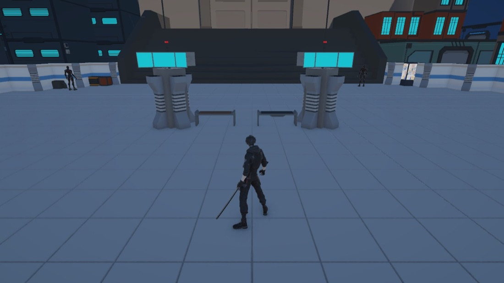 | 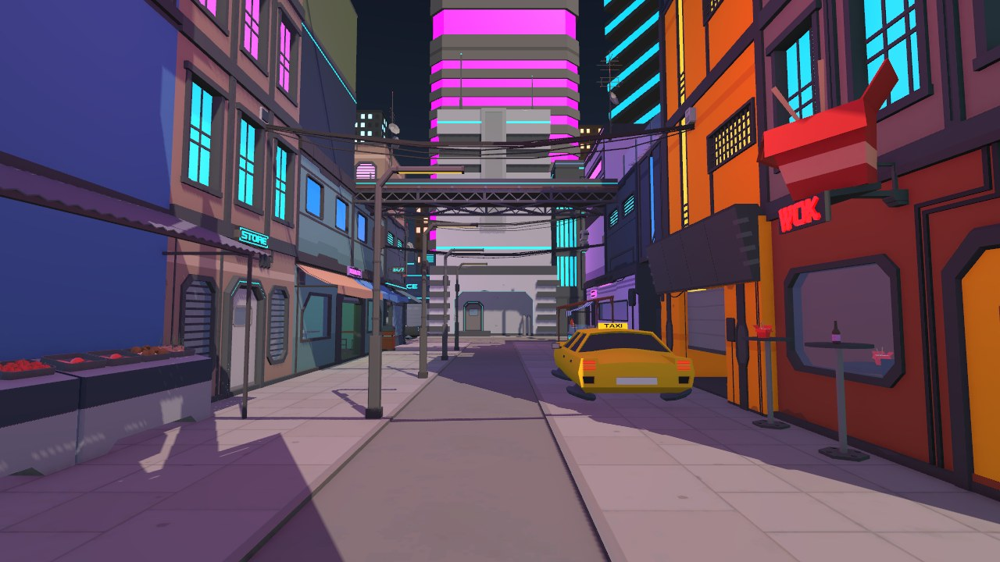 |

### 2.1 가져온 것과 뺀 것

빌더(`RebootNeonCityBuilder`)가 매번 처음부터 다시 만든다. 손으로 씬을 고친 것은 다시 빌드하면 사라진다.

- `Main.unity`에서 뺀 루트: `MainMap`(떠 있는 광장), `CenterMap`, `BackGroundMap`, `Cube`, `Sample`.
- 데모 씬에서 가져온 루트: `Floor`, `Buildings`, `Props`, `Vehicles`, `Nature`, `Light`. 카메라, 방향광, 후처리는 두고 왔다.
- 통행을 막던 것 정리
  - 경찰 테이프·기둥·게이트 틀 36개를 뺐다. 기둥에만 충돌이 있어 플레이어가 테이프를 뚫고 지나가고, 가장 넓은 공간(남쪽 도로와 타워 앞)을 둘로 갈랐다.
  - 작은 소품 269개의 충돌을 껐다(가로·세로 0.7m 미만, 높이 1.3m 미만. 의자, 스툴, 상자, 음식). 보이기는 하지만 플레이어도 적도 걸리지 않는다. 쓰레기통, 벤치, 테이블, 자판기, 차는 그대로 막는다.
- 2층으로 오르는 계단 둘을 추가했다. 팩의 계단·건물·바닥·난간 프리팹만 썼다.
  - 서쪽 도로 인도(x -16.25, z -4.5~9.5) → 서쪽 테라스
  - 중앙 골목 동쪽 벽(x 3.75, z -11.25~2.75) → 동쪽 테라스
  - 구조: 계단 한 층, 지붕이 중간 층계참인 키오스크, 계단 한 층, 유리 난간을 두른 위 층계참. 테라스 쪽 유리 난간은 두 칸씩 열었다.
  - 자리를 내느라 가로등 2개, 간판·실외기·케이블 6개, 테이블·자판기 등 소품 5개를 뺐고 택시 1대를 남쪽 도로로 옮겼다.
- 시작 위치: 남쪽 도로 위, 중앙 골목 입구(0.5, 0, -15). 북쪽을 본다.
- 무대 둘레는 팩의 큰 문(`SM_BigFence`)으로 이미 닫혀 있다. 보행 칸이 측정 상자 가장자리에 닿는 곳은 0칸이다.

### 2.2 층과 길

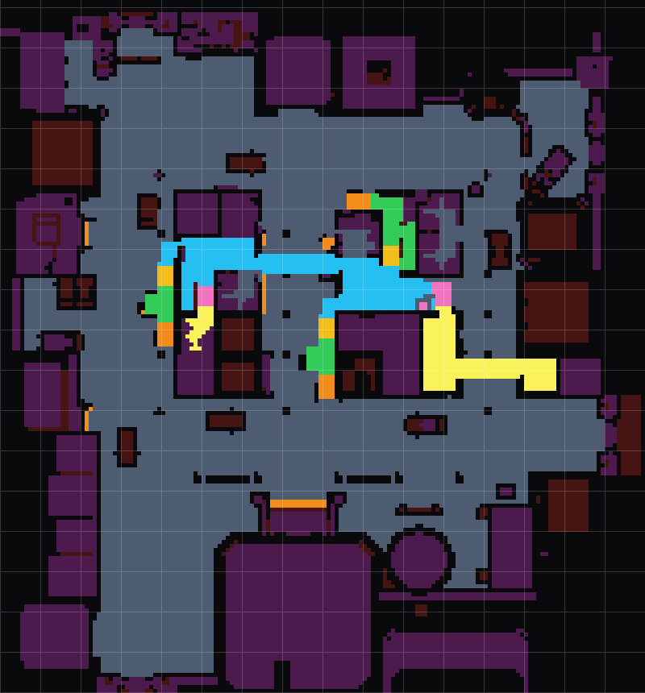

적이 걸을 수 있는 칸을 위에서 본 그림이다(한 칸 0.5m, 위가 북쪽). 회청색은 거리, 주황은 계단, 초록은 3.4m 층계참, 하늘색은 6.7m, 분홍은 6.7→9.9m 계단, 노랑은 9.9m다. 보라와 암적색은 갈 수 없는 지붕과 막힌 안쪽이다.

| 층 | 넓이 | 가는 길 |
| --- | --- | --- |
| 거리 | 2,577㎡ | 블록을 한 바퀴 도는 도로, 블록을 남북으로 가르는 골목(폭 10m), 타워 앞 |
| 2층 6.7m | 140㎡ | 계단 셋(북쪽 기존, 서쪽·골목 신규). 두 테라스를 골목 위 다리가 잇는다 |
| 3층 9.9m | 87㎡ | 2층에서 계단 둘. 동쪽 지붕은 다리로 끝 지붕까지 이어진다 |

## 3. 적의 복층 이동

### 3.1 방식

- `EnemyNavVolume`(씬에 하나)이 첫 라운드를 준비할 때 무대를 잰다. 0.5m 격자의 칸마다 위에서 아래로 Raycast해 설 수 있는 바닥을 층별로 찾고, 적 몸통(반지름 0.45m, 높이 1.9m)이 들어가는 칸만 남긴다. 계단 디딤판처럼 0.45m보다 낮은 것은 막지 않는다.
- `EnemyNavField`(순수 로직)가 이웃 칸을 잇는다. 두 칸의 중심을 잇는 경사가 40° 이하일 때만 걸어서 갈 수 있다. 그래서 테라스와 그 아래 골목은 계단으로만 이어진다. 대각선 이동은 양옆 칸이 모두 있어야 해서 벽 모서리를 깎아 지나가지 않는다.
- 뛰어내리기: 가장자리에 난간이 없고(가슴 높이에 걸리는 것이 없고), 아래 바닥까지 10.5m 이하이며, 떨어지는 통로가 비어 있으면 위 칸에서 아래 칸으로 한 방향 연결을 만든다. 올라가는 데는 쓰지 못한다. 플레이어가 지나갈 수 없는 난간은 적도 넘지 못한다.
- 경로는 적마다 구하지 않는다. 플레이어가 선 칸에서 바깥으로 한 번 훑어 모든 칸에 "다음 칸"을 적어 두고 모두가 같이 쓴다. 플레이어가 다른 칸으로 옮겼을 때만, 최대 0.1초에 한 번 다시 훑는다(1만 1,691칸에 0.28ms). 할당은 없다.
- 플레이어까지 곧게 걸어갈 수 있는 적은 전처럼 곧장 간다. 벽·낙차·다른 층이 사이에 있으면 경로를 따라 몇 칸 앞을 보고 걷는다.
- 군중에 밀려서는 떨어지지 않는다. 경로가 그 가장자리를 넘어갈 때만 뛰어내리고, 착지점까지 포물선으로 날아가 벽에서 떨어진다.

| 2층으로 올라온 플레이어를 계단으로 따라가는 적 | 플레이어가 골목으로 뛰어내린 4초 뒤 |
| --- | --- |
| 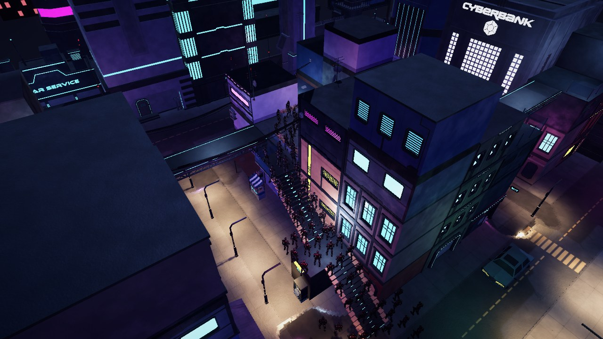 | 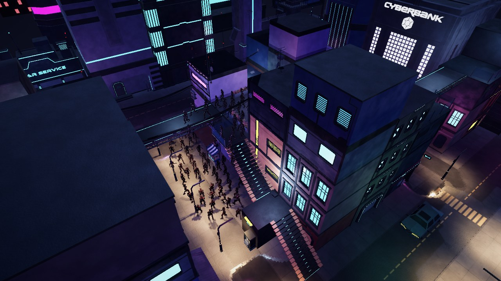 |

### 3.2 스폰

거리 규칙(플레이어에서 15~25m 고리)은 그대로다. 복층 무대에서만 다음이 더해진다.

- 고리 위에서 뽑은 점에 설 수 있는 칸이 있어야 한다. 한 기둥에 층이 여럿이면 그중 하나를 고른다.
- 플레이어에게 보이지 않는 칸을 먼저 쓴다. 모퉁이 뒤에서 걸어 나오게 하려는 것이다. 다시 뽑는 횟수는 기존 설정 `spawnVisibilityAttempts`를 쓴다.
- 플레이어까지 걷는 거리가 최대 스폰 거리의 2배(50m)를 넘는 칸은 건너뛴다(`spawnDetourLimit`). 플레이어가 끝 지붕처럼 가기 먼 곳에 있어 그런 칸뿐이면, 거리 규칙을 지키고 먼 길을 받아들인다. 이때 걷는 거리 중앙값은 58m였다.

### 3.3 판정

`EnemyNavVolume`이 있는 씬에서만 높이를 본다. 평지 씬은 전과 같이 평면 거리만 본다.

- 적의 공격: 높이 차가 `verticalReach`(2.2m, 한 층 3.3m보다 작게) 이내이고, 플레이어까지 걷는 거리가 공격 거리 + 1.5m 이내여야 한다. 데크 아래나 벽 너머에서는 때리지 못한다.
- 플레이어 특수 공격, 플레이어 주변에서 비켜서기, 적끼리 밀어내기도 다른 층은 뺀다.
- 플레이어의 일반·차지 공격은 원래 3D 물리 범위라 고치지 않았다.

### 3.4 스크립트 플레이 결과

플레이어는 공격하지 않고 서 있기만 했다. 위치는 순간이동으로 옮겼다.

| 상황 | 결과 |
| --- | --- |
| 시작 지점에 20초 | 첫 적이 2.5m 안에 3.9초. 20초에 100명 중 95명이 거리, 2.5m 안에 11명 |
| 동쪽 테라스(6.7m)로 이동, 35초 | 같은 층에 44명, 계단 층계참에 25명, 거리에 28명. 2m 넘게 올라온 적 68명 |
| 테라스에 선 채 적을 모두 처치, 25초 | 새 적 100명 중 98명이 거리에서 생겨 올라옴. 25초 뒤 같은 층에 53명 |
| 테라스 아래 골목으로 이동 | 4초 안에 30명이 뛰어내림. 20초 뒤 100명 전부 거리, 2.5m 안에 34명 |
| 끝 지붕(9.9m)으로 이동, 45초 | 첫 적 13.4초. 45초 뒤 같은 층에 88명 |
| 서쪽 도로로 이동, 20초 | 첫 적 8.3초. 20초 뒤에도 79명이 아직 2층. 끝 지붕에서 다리 하나로 돌아와야 해서 늦다 |

플레이어를 키보드로 걷게 한 결과:

- 새 계단 둘 모두 끝까지 올라가 위 층계참의 난간에서 멈췄다.
- 다리를 건너 반대편 테라스까지 갔다.
- 중간 층계참 옆으로 걸어 나가면 거리로 떨어져 착지한다.

## 4. 화면 스타일

### 4.1 카툰으로 보인 이유

- 팩의 모든 면이 팔레트 텍스처의 한 점 색이다. 노멀·거칠기·때 지도가 없고, 재질의 매끄러움이 0이다. 빛을 받아도 색 면으로만 보인다.
- 색 채도가 높고 조명은 흰 방향광 하나였다.
- 캐릭터(Meshy 모델)는 세부가 그려진 텍스처에 URP Lit이다. 그래서 캐릭터만 다른 그림처럼 떴다.

### 4.2 바꾼 것

| 항목 | 내용 |
| --- | --- |
| 표면 | 셰이더 `REBOOT/City Lit`. 팔레트 색은 그대로 두고 채도를 낮춘다(벽 0.52, 바닥 0.55). 월드 좌표 3방향 투영으로 잔요철 노멀과 마모·얼룩을 입혀 색과 광택이 고르지 않게 한다. 메시의 UV나 탄젠트는 쓰지 않는다. 조명 계산은 URP의 물리 기반 조명 그대로다 |
| 젖은 바닥 | 위를 보는 면은 어둡고 매끄럽게, 웅덩이 지도가 가리키는 곳은 거울처럼. 가로등과 간판이 비친다 |
| 발광 | 간판·창·등의 발광을 3.2배(원경 건물 2.4배)로 올려 블룸과 반사에 잡히게 했다 |
| 조명 | 달빛(방향광, 약하고 차가움, 부드러운 그림자), 그림자 없는 도시 반사광 1, 가로등 25(그중 6개만 그림자), 데모의 간판 채움광 36(0.7배로 낮춤), 위층 작업등 10. 모두 73개 |
| 반사 | 거리별 반사 프로브 6개를 빌드할 때 굽는다(128px) |
| 하늘·안개 | 밤하늘 셰이더(지평선 쪽 도시 불빛), 삼색 주변광, 지수 제곱 안개 0.011 |
| 색보정 | ACES 톤 매핑, 블룸, 대비 +10, 채도 -6, 차가운 화이트 밸런스, 비네트, 필름 그레인. 카메라는 SMAA |

텍스처 둘(잔요철, 마모)은 빌더가 잡음 함수로 만든다. 밖에서 가져온 자료는 없다.

| 화면만 바꾸기 전 | 뒤 |
| --- | --- |
|  | 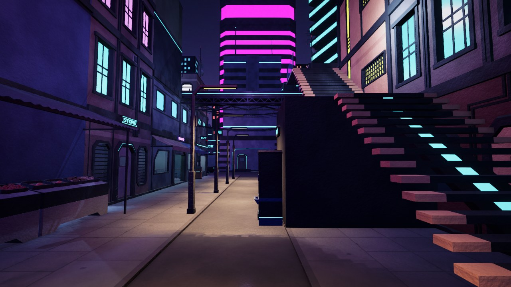 |
| 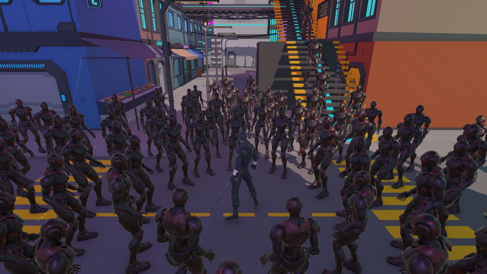 | 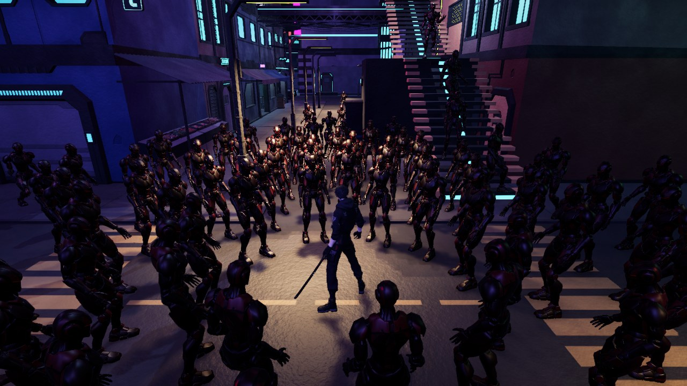 |
| 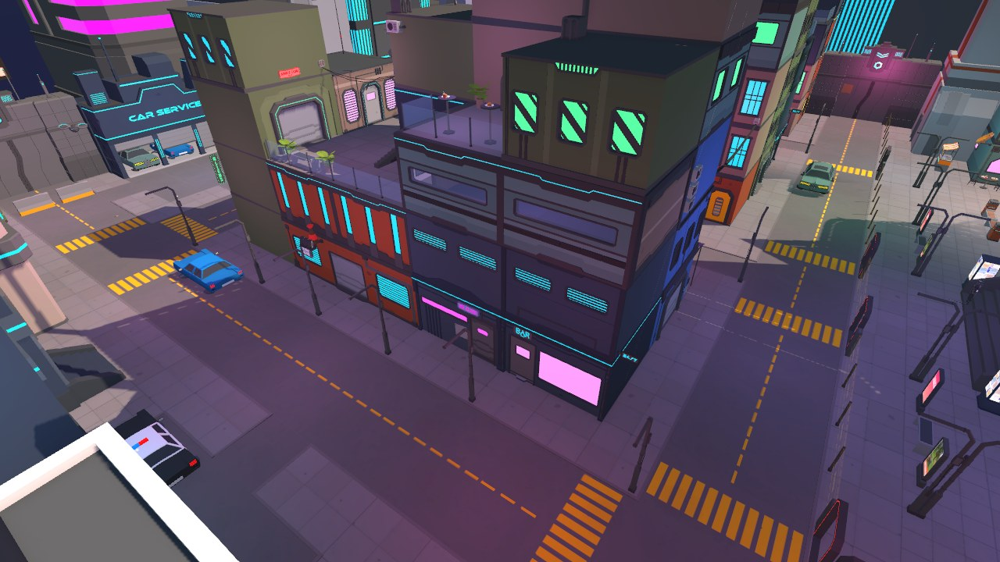 | 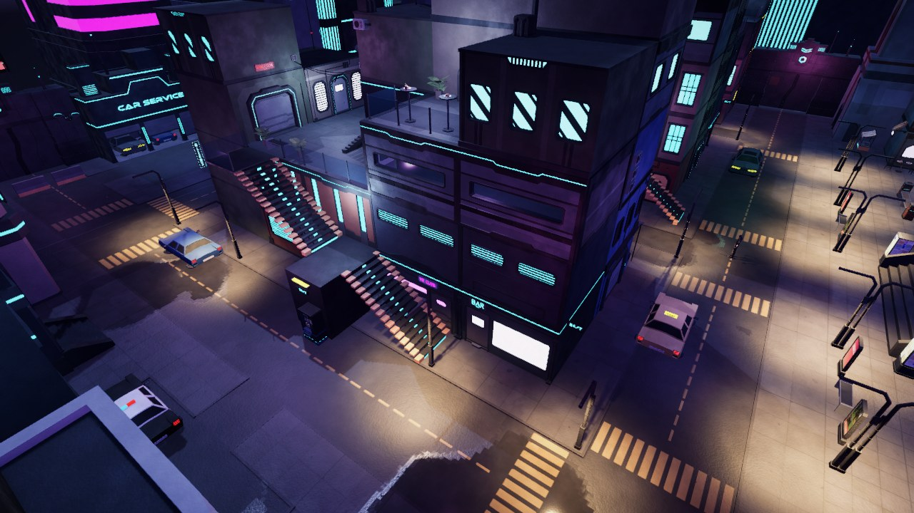 |

| 새 계단의 키오스크 | 2층 테라스의 전투 |
| --- | --- |
| 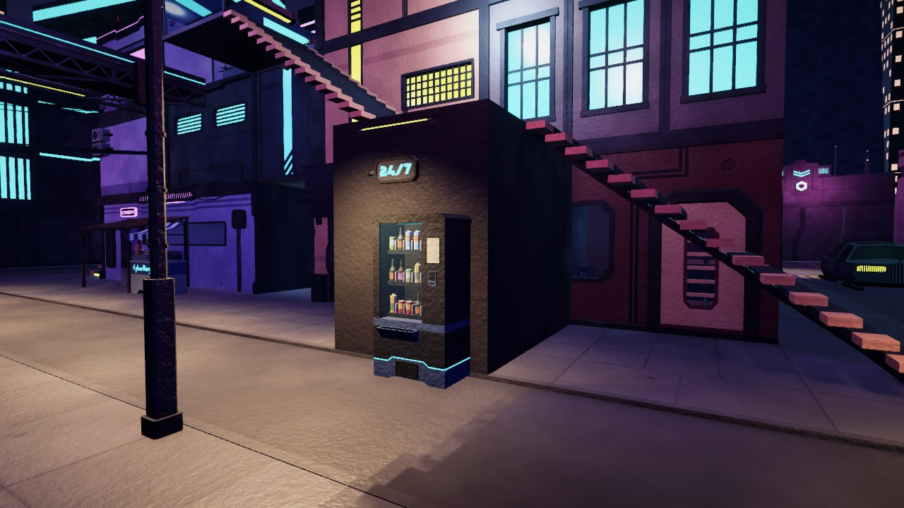 | 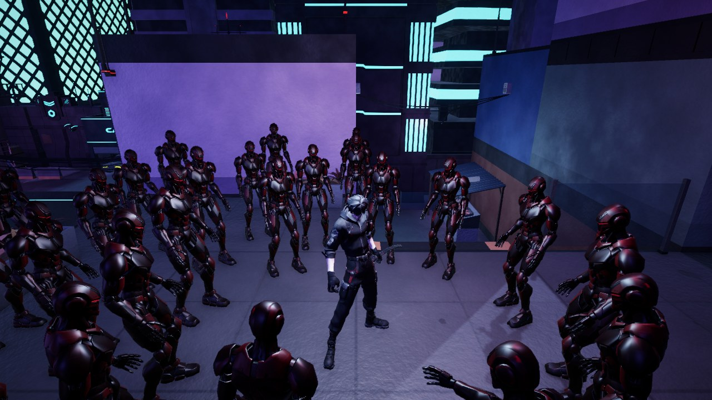 |

### 4.3 건드리지 않은 것

- 팩의 프리팹과 재질. 새 재질은 이 씬의 렌더러에만 걸었다(1,439개).
- 플레이어·적의 프리팹과 재질.
- URP 에셋과 렌더러 설정. SSAO는 세기 0.4, 반지름 0.3인 기본값 그대로다. 올리면 접지감이 더 나지만 모든 씬에 적용되므로 손대지 않았다.

## 5. 바뀐 파일

| 구분 | 파일 |
| --- | --- |
| 새 씬 | `Assets/Scenes/Main_NeonCity.unity` |
| 빌더 | `Assets/Editor/LevelDesign/RebootNeonCityBuilder.cs`, `RebootNeonCityLook.cs` |
| 길찾기 (새 파일) | `Assets/Scripts/Runtime/Enemy/EnemyNavField.cs`, `EnemyNavVolume.cs` |
| 적 코드 (적 담당 팀원의 영역) | `EnemyAgent.cs`, `EnemyRuntime.cs`, `EnemySettings.cs`. 설정 3개 추가: `verticalReach`, `pathRefreshSeconds`, `spawnDetourLimit` |
| 화면 에셋 | `Assets/LevelDesign/NeonCity/` 아래 셰이더 2, 재질 18, 텍스처 2, 반사 큐브맵 6, 볼륨 프로필 1 |
| 테스트 | `EnemyNavFieldTests`(15), `EnemyNavigationAgentTests`(5), `EnemyNavVolumeTests`(2), `NeonCitySceneTests`(5). PlayMode 테스트 어셈블리에 `Unity.RenderPipelines.Core.Runtime` 참조 추가 |

빌드 설정은 바꾸지 않았다. 빌드에 들어가는 씬은 여전히 `Main.unity` 하나다.

## 6. 해 보는 법

- 플레이: Editor에서 `Assets/Scenes/Main_NeonCity.unity`를 열고 Play.
- 다시 만들기: 메뉴 `Tools/REBOOT Level/Neon City: Rebuild Main_NeonCity From Main`, 또는

```bash
/Applications/Unity/Hub/Editor/6000.3.24f1/Unity.app/Contents/MacOS/Unity -batchmode -quit -projectPath . -executeMethod RebootNeonCityBuilder.BuildBatch -logFile build.log
```

팀원이 `Main.unity`의 UI나 매니저를 고치면 다시 만들어야 새 씬에 들어온다.

## 7. 확인하지 못한 것과 한계

- 사람이 플레이하지 않았다. 화면도 배치 실행의 캡처로만 맞췄다. 시연 모니터에서 밝기와 적 식별이 충분한지 봐야 한다.
- FPS와 GPU 부하를 재지 않았다. 실시간 조명 73개(그림자 있는 스폿 6개와 달빛), SSAO, 고품질 블룸, 프로브 6개가 더해졌다. 무거우면 가로등 그림자 수(`ShadowLampSpots`), 작업등, 블룸 품질부터 줄인다.
- 떨어지는 동작과 착지 동작이 없다. 달리는 자세로 최대 3층 높이를 떨어진다.
- 적은 칸 단위로 막힌다. 난간 끝이나 벤치 옆에서는 0.25m 안까지 붙는 프레임이 1.3% 있었다.
- 끝 지붕은 다리 하나로만 이어진 막다른 곳이다. 거기서 돌아 나오는 군중은 느리다(3.4절 마지막 줄).
- 새 계단은 폭 2.5m라 적이 둘씩 지나간다.
- 반사 프로브는 고정이라 캐릭터는 비치지 않는다.
- 점프는 여전히 없다. 플레이어는 계단과 낙하로만 층을 옮긴다.

## 8. 팀이 정할 것

1. ~~이 무대를 빌드 씬으로 쓸지.~~ 2026-11-25 정했다: 빌드에는 이 무대 하나만 넣는다(`ProjectSettings/EditorBuildSettings.asset`). 평지 아레나(`Main.unity`)는 프로젝트에 남아 테스트와 A/B 측정에 쓰이고, PlayMode 테스트는 빌드 목록이 아니라 `Assets/Tests/PlayMode/TestScenes.cs`로 씬을 연다.
2. 복층 스폰 규칙. 시야 밖 우선과 우회 한도는 이번에 임시로 정했다.
3. `verticalReach` 2.2m, 낙하 한도 10.5m. 3층에서 그대로 뛰어내리는 것이 어색하면 낙하 한도를 7m로 내리면 2층까지만 뛰어내린다.
4. 작은 소품을 통과하게 둔 것과 경찰 테이프를 뺀 것.
5. 밤 화면의 밝기와 보라색 기운. 재질·조명 값은 `RebootNeonCityLook.cs` 한 파일에 있다.
6. SSAO 세기(공용 설정).

## 9. 에셋 출처

| 에셋 | 사용 | 출처·권한 |
| --- | --- | --- |
| `LowPolySciFiCity` (데모 씬 배치, 프리팹, 재질, 텍스처) | 무대 전체 | **미확인**. 저장소에 라이선스·출처 문서가 없다 |
| `Assets/LevelDesign/NeonCity/*` | 신규 | 이번 작업에서 스크립트로 만들었다. 반사 큐브맵은 이 씬을 찍은 것이다 |
| `MeshyImports` (플레이어·적) | 수정 없음 | **미확인** |
